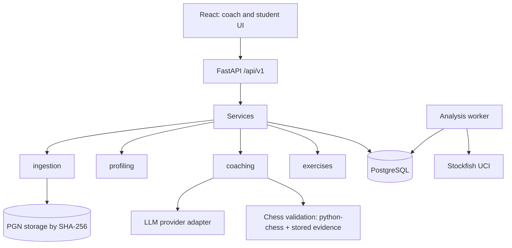

# Architecture

## Shape

The system is a modular monolith. One Python package, `chesscoach`, has two entry points:

- **API** (`uvicorn chesscoach.api.main:app`): FastAPI with thin routes over services.
- **Worker** (`python -m chesscoach.analysis.worker`, Phase 3): polls the PostgreSQL `analysis_runs` job table and runs Stockfish.

The **frontend** (React + TypeScript, Phase 8) talks to the API only.



## Data flow

1. **Import.** The PGN is stored under its SHA-256 key. Each game is parsed, validated, mapped to a student through aliases, deduplicated by game hash, and persisted. An import report is returned.
2. **Analyze.** A `POST /games/{id}/analyze` request creates a queued `analysis_runs` row. A worker claims it (`SELECT … FOR UPDATE SKIP LOCKED` on PostgreSQL) and writes `move_analyses`. All scores are normalized to the student's point of view.
3. **Classify.** When the final analysis pass completes, the worker calls `classification`. It turns move evidence into candidate `weakness_observations` and `skill_opportunities`, tagged with `classifier_version`. Coaches confirm, reject or correct the candidates.
4. **Profile.** After each classification, the worker rebuilds the profile. Weighted observations and opportunities become a new `profile_snapshots` version, created only if the evidence fingerprint changed. Nobody rebuilds it by hand any more: findings are not reviewed in the product (see AGENTS.md).
5. **Coach.** The latest profile and 2–5 representative positions go into a versioned prompt. The LLM output is validated with Pydantic and then with chess and database checks, and stored as a `coaching_session`.
6. **Practice.** Exercises are drawn from analyzed positions, and attempts are recorded.

## Package layout

```
src/chesscoach/
  core/         config (pydantic-settings), logging, errors
  db/           SQLAlchemy base, portable types, models, session
  api/          FastAPI app, dependencies (auth stub), routes/, schemas
  ingestion/    PGN parsing, identity resolution, storage, import service
  analysis/     engine wrapper, score normalization, features, worker (Phase 3)
  classification/ taxonomy, motif detectors, classifier rules, admin-only research labelling (Phase 4)
  profiling/    aggregation into versioned profiles (Phase 5)
  coaching/     provider adapters, retrieval, prompts, validation (Phase 6); plan.py: Chess LLM improvement plans
  exercises/    selection and attempts (Phase 7)
  puzzles/      Lichess puzzle import, rising-difficulty sets per mistake, puzzle ratings
  evaluation/   baselines and metrics (Phase 9)
  annotation/   display verdicts and board-derived reasons for both sides
  mistakes.py   a student's mistakes per game, acknowledgements, "flagged again"
  cohort.py     coach overview of mistakes across their students
config/         skill_taxonomy.yaml, analysis presets
prompts/        versioned prompt templates
migrations/     Alembic
tests/          unit/, integration/, fixtures/
frontend/       React app (Phase 8)
```

## Key decisions

| Decision | Choice | Why |
|---|---|---|
| Job queue | `analysis_runs` table used as the queue | Enough for a pilot of 30 students, with no extra infrastructure. |
| DB portability | Generic `Uuid`, JSON with a JSONB variant, non-native enums | The same models run on PostgreSQL and in SQLite tests. |
| File storage | Local directory, key = SHA-256 | Idempotent and safe from path traversal. Can be swapped for S3 later. |
| Auth (MVP) | Development stub, then JWT and roles in Phase 8 | `student_access` checks exist in services from the start. |
| LLM | `LLMProvider` protocol with OpenAI-compatible and Anthropic adapters plus a mock | Provider independence and deterministic tests. |
