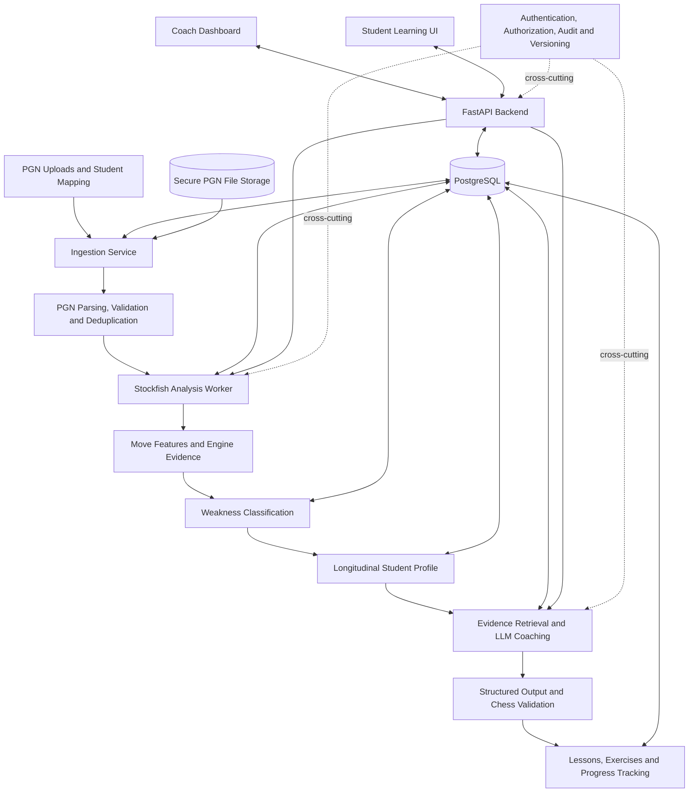
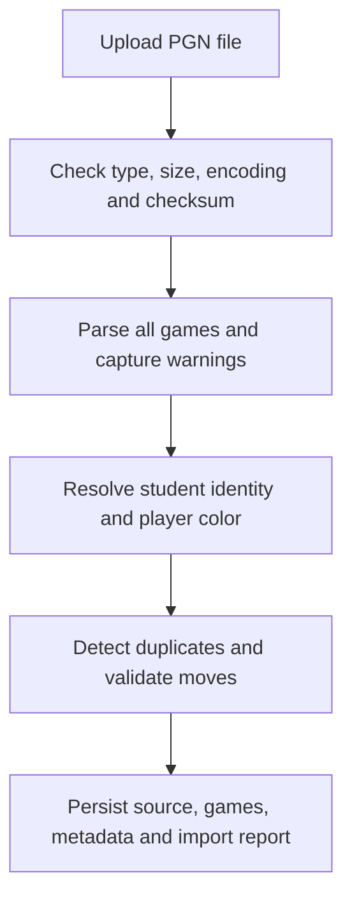

# Personalized Chess LLM Coach
## Comprehensive Project Specification and Codex Implementation Brief

This document is designed to serve two purposes:

1. **Project blueprint:** Define the background, problem, objectives, architecture, data model, chess analysis methodology, student modelling, LLM integration, evaluation, and deployment.
2. **Implementation specification for Codex:** Provide clear engineering requirements, a phased build plan, acceptance criteria, and a master prompt that can be used to start developing the actual application.

The project is intended to produce both a working personalized chess coaching platform and a credible AI/ML research project.

---

# Part I — Project background and vision

## 1. Project overview

**Proposed project name:** ChessMentor AI — Personalized Chess Coaching Through Engine-Grounded LLMs

**Project type:** AI/ML application, chess analytics platform, personalized learning system, and applied research project.

The proposed system will analyze chess games played by individual students, identify recurring weaknesses, build a personalized model of each student's chess abilities, and use a large language model (LLM) to generate targeted explanations, exercises, and improvement plans.

The initial target is 10–30 students, with approximately 50 historical games available per student. Games will be imported from PGN files. The system will use Stockfish for chess analysis and an external LLM API for natural-language coaching.

The application should support both student-facing learning and coach-facing analysis.

## 2. The problem we are solving

Traditional chess analysis tools are excellent at evaluating positions, identifying tactical mistakes, and suggesting stronger moves. However, evaluating a position and understanding a student's learning needs are two different tasks.

Consider three students who each make a significant mistake in a game:

- Student A repeatedly overlooks forks and pins.
- Student B understands tactics but makes poor decisions in rook endgames.
- Student C frequently makes reasonable moves but spends too long thinking and makes errors under time pressure.

A conventional engine report may flag all three mistakes. A personalized coach should identify three different training priorities.

The system should therefore answer five questions:

1. **What happened?** Which moves and positions contained meaningful errors or missed opportunities?
2. **Why might it matter?** Which chess skill could explain the observed pattern?
3. **How strong is the evidence?** Is this a recurring issue or an isolated mistake?
4. **What should the student do next?** Which lesson or exercise is appropriate?
5. **Did it help?** Does subsequent performance show improvement?

The system must distinguish verified facts from hypotheses. An engine can establish that a move loses an advantage under its analysis settings; it cannot directly establish what the student was thinking.

## 3. Project objectives

### Primary objectives

- Import and validate PGN games for individual students.
- Analyze positions and moves with Stockfish.
- Extract meaningful chess performance features.
- Identify recurring candidate weaknesses across games.
- Maintain a personalized, longitudinal student skill profile.
- Use an LLM API to explain verified findings in accessible language.
- Generate targeted exercises and individualized improvement plans.
- Track exercise outcomes and changes in future games.
- Give coaches a way to inspect evidence, correct classifications, and review progress.

### Research objectives

- Develop and evaluate a taxonomy for chess weaknesses.
- Compare rule-based weakness detection with manually annotated examples.
- Investigate how much game history is required for useful student profiling.
- Compare engine-only feedback, rule-based personalized reports, and LLM-generated personalized coaching.
- Measure the quality, factual grounding, and educational usefulness of the generated lessons.
- Investigate whether targeted training reduces recurrence of specific error types.

### Non-objectives for the first version

The initial system will **not**:

- Train a foundation LLM from scratch.
- Train a separate LLM for each student.
- Replace Stockfish with an LLM for move calculation.
- Assume that every engine mistake has a reliably identifiable psychological cause.
- Automatically claim that a student has improved simply because a lesson was completed.
- Require integration with the live Chess.com or Lichess APIs. The first version will work with uploaded PGN files.
- Require a multi-agent framework, distributed compute cluster, or complex vector database.

These exclusions are deliberate. They keep the MVP achievable and allow the research to focus on personalization and learning outcomes.

## 4. Core design principles

These principles should guide every implementation decision and should be included in the project's `AGENTS.md` file so Codex can follow them throughout development.

| Principle | Engineering requirement |
|---|---|
| Engine-grounded | Stockfish is the authority for engine evaluations and candidate lines. |
| Evidence-first | Every reported weakness must link to specific analyzed positions. |
| Personalized | The system maintains a separate profile and learning history for each student. |
| Uncertainty-aware | Insufficient evidence must result in an uncertain or unclassified finding, not a confident diagnosis. |
| Reproducible | Store engine settings, analysis versions, classifier versions, and prompt versions. |
| Human-reviewable | Coaches can inspect evidence, correct classifications, and annotate candidate weaknesses. |
| Provider-independent | The LLM provider and model are configurable without changing chess-analysis logic. |
| Privacy-conscious | Students' games, profiles, and learning records are access-controlled. |
| Research-ready | Data splits, baselines, metrics, and experiment configurations are recorded from the beginning. |
| Incremental | New games update the existing profile without requiring complete reprocessing of the student's history. |

## 5. What the finished application should look like

The application should have two main interfaces.

### Coach dashboard

- Manage 10–30 students.
- Upload and review PGN files.
- View game-analysis jobs and errors.
- Inspect weaknesses and supporting positions.
- Approve or correct classifications.
- Review personalized lesson plans and progress.

### Student learning interface

- View a personal performance summary.
- Explore analyzed games on a chessboard.
- Ask questions about specific positions.
- Complete targeted tactical and positional exercises.
- Receive a weekly training plan.
- Track progress on previously identified skills.

For the first version, prioritize a reliable coach dashboard and a functional student lesson view. Advanced social features, tournaments, live-game assistance, and mobile-native applications are outside the initial scope.

---

# Part II — High-level system architecture

## 6. Architecture diagram

The architecture separates chess computation, student modelling, LLM orchestration, persistence, and the user interface.



### Main pipeline

**Input layer:** PGN uploads, student identity mapping, import validation.

**Ingestion service:** PGN parsing, metadata normalization, duplicate detection, immutable source files.

**Chess analysis service:** python-chess, Stockfish UCI, evaluation normalization, best lines, critical positions.

**Weakness intelligence:** Tactical detectors, move features, error classification, coach review.

**Longitudinal student model:** Opportunity-adjusted rates, recurrence, confidence, skill priorities, progress.

**LLM coaching service:** Evidence retrieval, prompt templates, LLM API, structured output, validation.

**Learning experience:** Game review, lessons, exercises, feedback, progress reports.

**Shared persistence layer:** PostgreSQL stores structured data, analysis evidence, profile versions, lessons, and exercise outcomes. Raw PGN files are retained separately with checksums.

**Cross-cutting controls:** Authentication, authorization, logging, versioning, error handling, privacy, and evaluation.

## 7. Recommended technology stack

| Layer | Choice | Reason |
|---|---|---|
| Language | Python 3.11+ | Ecosystem support for chess, data processing, and ML |
| Chess library | `python-chess` | PGN parsing, board representation, legal move validation, UCI |
| Engine | Stockfish | Reproducible chess analysis |
| Backend | FastAPI | Typed API and automatic API documentation |
| Data validation | Pydantic | Request and response validation |
| ORM | SQLAlchemy 2.x | Structured database access |
| Database | PostgreSQL | Relational integrity and JSONB |
| Migrations | Alembic | Reproducible schema changes |
| LLM client | OpenAI-compatible adapter or provider SDK | Configurable hosted model |
| Testing | pytest | Unit and integration tests |
| Frontend | React + TypeScript | Interactive board and dashboards |
| Chessboard UI | `react-chessboard` or an equivalent maintained library | Board rendering and move interaction |
| Frontend chess logic | `chess.js` | Client-side legal moves and FEN validation |
| Deployment | Docker Compose | Reproducible local development and deployment |

Use a supported, tested Python version and pin dependencies. Avoid installing unpinned latest versions automatically during every deployment.

For a small pilot, a separate worker process and PostgreSQL-backed job table are sufficient. Add Redis and a task queue only if the job volume or operational requirements justify them.

## 8. Component responsibilities and boundaries

### A. Ingestion module

Reads PGN files, validates game records, resolves student identity, extracts metadata, calculates file checksums, and creates import records. It must not call the LLM.

### B. Analysis module

Runs Stockfish and calculates move-level features. It must not generate coaching language or modify student profiles directly.

### C. Classification module

Converts verified move-level evidence into candidate skill observations. It must preserve uncertainty and distinguish rule-derived labels from coach-confirmed labels.

### D. Profiling module

Aggregates observations over time and produces versioned student skill profiles. It must not treat unreviewed candidate classifications as ground truth.

### E. Coaching module

Retrieves evidence, builds prompts, calls the LLM API, validates responses, and persists coaching sessions.

### F. Exercise and evaluation module

Selects appropriate positions, records student attempts, tracks repeated errors, and calculates experimental metrics.

### G. API and interface

Provides authenticated access to students, games, profiles, analysis jobs, coaching, and progress.

The LLM should never have direct database credentials, unrestricted filesystem access, or authority to modify engine-analysis records. All data should flow through application services.

---

# Part III — Data model and data lifecycle

## 9. Data sources and initial assumptions

The MVP will use PGN files only. PGN is the standard textual representation for chess games and can contain headers, moves, results, comments, annotations, and optional clock information.

A single file may contain multiple games. Student names may differ between files, and some games may lack dates, time controls, ratings, or clock annotations.

Codex must therefore implement an explicit student-to-player mapping process.

For example, a coach may upload a PGN containing 100 games and map one or more player names to a student record. Ambiguous mappings must be flagged for confirmation rather than silently assigned.

### Required import metadata

- Original filename and SHA-256 checksum.
- Import timestamp and importing user.
- PGN game index within the source file.
- Original PGN headers.
- White and Black player names as recorded.
- Student identity and color, when resolved.
- Game result and played date, if present.
- Time control and clock annotations, if present.
- Import status and validation warnings.

Preserve the original PGN content. Normalized metadata and analysis outputs should be stored separately.

## 10. Database schema specification

The following entities form the initial data model. Codex should create SQLAlchemy models, Alembic migrations, foreign-key constraints, and indexes.

### Core entities

**`users`**

Application accounts and roles: `id`, `email`, `password_hash` or external-auth identifier, `role`, `is_active`, timestamps.

**`students`**

`id`, `display_name`, `rating_estimate`, `rating_source`, `skill_level`, `learning_preferences`, `created_at`, `updated_at`.

**`student_access`**

Associates application users with students they are permitted to view or coach. This prevents one student from accessing another student's data.

**`source_files`**

`id`, `original_filename`, `sha256`, `storage_key`, `file_size`, `uploaded_by`, `import_status`, `warnings`, `created_at`.

**`games`**

`id`, `source_file_id`, `game_index`, `white_name`, `black_name`, `student_id`, `student_color`, `result`, `played_at`, `time_control`, `opening_eco`, `pgn_headers`, `raw_pgn`, `created_at`.

**`analysis_runs`**

`id`, `game_id`, `engine_name`, `engine_version`, `engine_checksum`, `configuration`, `analysis_version`, `status`, `started_at`, `completed_at`, `error_message`.

**`move_analyses`**

`id`, `analysis_run_id`, `ply`, `fen_before`, `fen_after`, `uci_move`, `san_move`, `student_move`, `phase`, `eval_before_cp`, `eval_after_cp`, `eval_before_mate`, `eval_after_mate`, `best_move_uci`, `principal_variation`, `best_move_loss_cp`, `clock_before_ms`, `clock_after_ms`.

**`weakness_observations`**

`id`, `student_id`, `game_id`, `move_analysis_id`, `skill_code`, `subskill_code`, `evidence_type`, `severity`, `confidence`, `classifier_version`, `review_status`, `reviewed_by`, `reviewed_at`.

**`student_skill_profiles`**

`id`, `student_id`, `skill_code`, `profile_version`, `error_rate`, `opportunity_count`, `error_count`, `games_affected`, `confidence`, `priority_score`, `evidence_summary`, `generated_at`.

**`learning_plans`**

`id`, `student_id`, `profile_version`, `objective`, `weekly_goals`, `recommended_skills`, `status`, `created_at`, `updated_at`.

**`coaching_sessions`**

`id`, `student_id`, `learning_plan_id`, `model_provider`, `model_id`, `prompt_version`, `evidence_references`, `request_metadata`, `response_json`, `validation_status`, `token_usage`, `created_at`.

**`exercises` and `exercise_attempts`**

Store the exercise position, target skill, source and answer provenance, attempts, correctness, hints used, completion timestamps, and measured outcomes.

**`audit_events`**

Record important actions such as imports, analysis requests, classification corrections, access changes, and deletion requests.

### Database implementation rules

1. Use UUID primary keys for externally referenced entities.
2. Store timestamps in UTC.
3. Use explicit enums or validated constants for game results, colors, job statuses, review statuses, and skill codes.
4. Index `student_id`, `game_id`, `analysis_run_id`, `skill_code`, and relevant timestamps.
5. Use JSONB for flexible metadata, not as a substitute for relational fields used in queries.
6. Make game imports idempotent using checksums and game identity checks.
7. Enforce ownership and access rules in the service layer and, where appropriate, database constraints.
8. Keep raw PGN files and historical analysis runs intact when profiles are recalculated.
9. Avoid storing unnecessary personal information.
10. Implement deletion and retention behavior for student data according to the project's privacy requirements.

## 11. Game ingestion and validation workflow



A PGN file can contain valid games alongside malformed ones. The importer should report which games were imported, skipped, or rejected, and why. It should not silently discard malformed records.

The service should also distinguish between a student's actual move and the opponent's move. Only student moves should contribute to the student's move-quality statistics, while opponent moves can still provide evidence about missed opportunities and practical decision-making.

---

# Part IV — Chess analysis and weakness intelligence

## 12. Stockfish analysis specification

Implement the engine integration using `python-chess` and the Stockfish UCI interface.

For each game, reconstruct the board position before and after each student move and record:

- FEN before and after the move.
- UCI and SAN notation of the actual move.
- Side to move and student color.
- Engine evaluation from the student's perspective.
- Best move and principal variation.
- Evaluation after the played move.
- Mate scores, when present.
- Search depth or time budget.
- Relevant clock information, if present.
- Game phase and material features.
- Engine configuration and analysis-run version.

### Evaluation convention

Normalize every ordinary evaluation to the student's perspective. Let \(V_{\text{before}}\) denote the engine evaluation of the position before the student's move, and \(V_{\text{after}}\) the evaluation after the move, with both values measured from the same perspective.

A basic estimate of evaluation loss is:

\[
L = \max(0,V_{\text{before}}-V_{\text{after}})
\]

This formula is only applicable when both scores are comparable ordinary centipawn evaluations. Mate transitions, unavailable scores, forced sequences, and unstable evaluations need separate handling.

The application must not compare scores from different perspectives or silently convert mate distances into ordinary centipawns.

### Analysis settings

Make these settings configurable:

- Stockfish binary path and version.
- Search depth or time per position.
- Threads and hash size.
- Number of principal variations.
- Opening and critical-position analysis settings.
- Retry limits and maximum concurrent games.
- Optional deeper analysis for critical positions.

Use fixed settings for initial baseline comparisons. Do not assume depth 16 is sufficient for every position; the initial depth should be treated as a tunable compute/quality trade-off.

### Two-pass analysis

**Pass 1: Baseline analysis**

Analyze the student's decisions with a consistent budget and save the results.

**Pass 2: Critical-position analysis**

Reanalyze positions flagged as potentially important with a larger budget. This helps distinguish robust errors from search instability and identifies positions worth showing in lessons.

For a future version, consider analyzing multiple candidate lines, comparing the best move with the move played, and measuring uncertainty across repeated analyses where necessary.

### Engine pipeline acceptance criteria

- Every analyzed move can be traced to a game and analysis run.
- Scores use a consistent perspective.
- Mate scores are represented explicitly.
- Legal moves and FEN positions can be reconstructed.
- Engine failures can be retried without duplicate records.
- Analysis settings are persisted.
- Critical positions can be reanalyzed independently.
- The pipeline supports incremental processing of new games.

## 13. Weakness taxonomy

Implement a versioned taxonomy in `config/skill_taxonomy.yaml`.

| Main category | Example subskills |
|---|---|
| Tactical awareness | Forks, pins, skewers, discovered attacks, hanging pieces, mating patterns |
| Calculation | Forcing variations, intermediate moves, defensive resources, variation accuracy |
| Positional play | Pawn structure, weak squares, piece activity, king safety, strategic planning |
| Opening knowledge | Development, opening principles, repertoire deviations, opening traps |
| Endgame technique | King activity, pawn endgames, rook endgames, conversion, defensive holds |
| Defensive skills | Finding resources, threat prevention, simplifying under pressure |
| Winning-position conversion | Preserving advantages, selecting practical continuations, reducing counterplay |
| Practical play | Time management, decision consistency, handling complex positions |

Treat this as a proposed taxonomy, not a claim that every category can be inferred reliably from a PGN alone.

For example, the system may detect an inaccurate opening move, but it cannot call it a lack of opening knowledge without further context. A player may intentionally choose a playable sideline.

Likewise, a tactical oversight does not prove a calculation weakness. The student might have recognized the tactic but overlooked it while managing time.

The classifier must support `unclassified` and `insufficient_evidence` outcomes.

## 14. Initial classification algorithm

For every candidate student decision:

1. Calculate the evaluation loss when scores are comparable.
2. Identify the game phase.
3. Extract board features and candidate tactical motifs.
4. Check whether the move was a forced or practically constrained choice.
5. Determine whether an identified motif is actually supported by the position.
6. Create candidate weakness observations with supporting evidence.
7. Assign a confidence estimate only where it has a defensible interpretation.
8. Allow a coach to confirm, reject, or correct the candidate classification.

The system should distinguish between:

- **Move-quality evidence:** The move was worse than an engine alternative.
- **Motif evidence:** A specific tactical pattern was available or missed.
- **Skill inference:** The pattern suggests a potential learning need.
- **Coach-confirmed finding:** A human reviewer has accepted the classification.

These should not be collapsed into a single label.

For example, a move may have high evaluation loss but no reliable tactical motif. The system should record the move-quality issue without inventing a tactical explanation.

### Classifier implementation stages

- Version 1: Evaluation thresholds, game-phase classification, and simple board-feature rules.
- Version 2: Explicit tactical motif detectors for a small number of patterns.
- Version 3: Coach-reviewed classification dataset.
- Version 4: Supervised ML model, only if the annotated dataset is large and diverse enough.
- Version 5: Compare rule-based and learned classifiers on held-out games and positions.

The first research benchmark should include manually reviewed examples from multiple students, with consistent annotation guidelines.

---

# Part V — Personalized student modelling

## 15. Profile construction

The profile service should summarize evidence across a student's analyzed games and update when new evidence becomes available.

For every skill, calculate or store:

- Number of relevant opportunities.
- Number of verified or candidate errors.
- Number of distinct games containing the pattern.
- Error frequency, where opportunity detection is reliable.
- Severity-weighted performance indicators.
- Recency and time distribution of observations.
- Classification confidence and review status.
- Exercise accuracy for the relevant skill.
- Changes relative to earlier profile snapshots.

### Opportunity-adjusted metrics

A student who misses four tactical opportunities in five relevant positions may need a different intervention from a student who misses four in 80 relevant positions.

Use:

\[
\text{Error rate}=\frac{\text{Verified errors}}{\text{Relevant opportunities}}
\]

Only report the ratio when the opportunity detector is reliable enough. Store the numerator and denominator so a coach can interpret the result.

### Confidence and uncertainty

A basic smoothed estimate can use a Beta-Binomial model:

\[
\hat p=\frac{e+\alpha}{n+\alpha+\beta}
\]

where \(e\) is the verified error count, \(n\) is the number of relevant opportunities, and \(\alpha,\beta\) are prior parameters.

This is a starting point, not a complete model of chess skill. It assumes a simplified binary outcome and does not automatically account for varying position difficulty or correlated moves within the same game.

The profile should not label a skill as a persistent weakness based on only one or two observations.

### Recurrence across games

A recurring pattern should have evidence from multiple distinct games. The system should also avoid treating ten similar positions from one game as equivalent to ten independent games.

Keep the following concepts separate:

- Error frequency.
- Severity.
- Recurrence.
- Evidence confidence.
- Training priority.

A high training priority is a recommendation, not a direct estimate of the student's ability.

## 16. Learning-priority calculation

Implement a configurable priority function, with normalized inputs:

\[
P_k=E_k\times S_k\times R_k\times C_k
\]

where:

- \(E_k\): estimated error rate for skill \(k\).
- \(S_k\): severity or practical importance.
- \(R_k\): recurrence across games.
- \(C_k\): evidence confidence.

The exact formula and thresholds must be versioned and empirically evaluated. Do not claim that this heuristic is validated until it has been tested.

The selection process should also consider exploration: an under-observed skill may need a diagnostic exercise rather than being ignored indefinitely.

## 17. Personalized learning plans

Each student should receive a structured learning plan containing:

- One primary learning objective.
- One secondary objective.
- Representative game positions.
- Short explanations of the evidence.
- Recommended exercises.
- A measurable follow-up criterion.
- A review date or condition for reassessment.

For example, if the system detects a recurring pattern of missed forks, it might recommend a short set of fork-recognition exercises, then assess the student's performance on unseen positions before deciding whether to continue, change, or retire that objective.

Do not assume a skill has improved merely because the student completed the exercises. Use exercise performance and subsequent game evidence.

---

# Part VI — LLM coaching implementation

## 18. LLM architecture

Use an external LLM API with a provider abstraction. The application should be able to switch providers or models without changing the chess analysis, database schema, or student profiling logic.

The LLM's responsibilities are:

- Explain verified engine findings.
- Describe recurring patterns using actual game evidence.
- Ask the student to calculate before revealing a solution.
- Recommend exercises that match the selected learning objective.
- Produce weekly plans in a consistent structure.
- Answer follow-up questions about a specific position.
- Adjust the complexity of explanations to the student's level.

The LLM should not be responsible for:

- Calculating the authoritative best move.
- Deciding whether a move is legal without validation.
- Creating unsupported claims about a student's past games.
- Independently modifying the student's skill profile.
- Claiming that a psychological or cognitive problem caused a chess mistake.

## 19. Evidence retrieval

Before each LLM request, build a compact coaching context from the database.

Retrieve:

1. The latest student profile snapshot.
2. The selected learning objective and priority evidence.
3. Two to five representative positions from different games where possible.
4. The actual moves and engine alternatives.
5. Verified principal variations.
6. Previous lesson and exercise outcomes.
7. Relevant coaching materials, if available.

Each position should include its game ID, ply, FEN, move played, engine alternative, evaluation information, and evidence classification.

Do not send all 50 games to the LLM by default. Retrieval improves efficiency and makes it easier to trace explanations to specific evidence.

## 20. Prompt specification

Create a versioned prompt file such as `prompts/chess_coach_v1.txt`.

```text
ROLE
You are a supportive chess coach who explains verified chess
analysis and helps students improve through deliberate practice.

GROUNDING REQUIREMENTS
- Use supplied game evidence for all claims about the student.
- Do not invent games, positions, moves, evaluations, or history.
- Treat Stockfish analysis as evidence about positions, not proof
  of what a student was thinking.
- Distinguish observed facts from inferred skill gaps.
- State when evidence is insufficient.
- Interpret all evaluations from the stated player's perspective.
- Use only supplied engine variations for authoritative move claims.
- Never claim a move is legal without a valid board position.
- Avoid unnecessary jargon; explain technical concepts clearly.
- Ask the student to calculate before revealing a solution when
  the interaction is a training exercise.
- Never shame students or present temporary errors as fixed traits.

INPUT CONTEXT
Student level:
Student learning preferences:
Current learning objective:
Profile evidence:
Relevant game positions:
Engine analysis:
Previous lessons:
Exercise history:

TASK
Create a personalized coaching response based on the evidence.

OUTPUT
1. Learning objective.
2. Explanation of the observed pattern.
3. One or two relevant game examples.
4. An interactive question or calculation prompt.
5. A targeted exercise recommendation.
6. A measurable follow-up criterion.
7. Important uncertainty or missing evidence.

The response must distinguish verified facts from hypotheses.
```

Store the prompt version with every coaching session so that changes in generated explanations can be traced to changes in the prompt or model.

## 21. Structured output and validation

Use Pydantic to define a response schema. At minimum, each coaching response should contain:

- `objective`
- `recurring_pattern`
- `examples`
- `student_question`
- `exercise_recommendation`
- `follow_up_metric`
- `uncertainty`

Each example should include a game ID, ply, FEN, and explanation.

Before presenting a response, the application must:

1. Verify that the game belongs to the requested student.
2. Confirm that the referenced FEN matches the stored position.
3. Validate any suggested move against the board.
4. Check engine claims against stored evidence or rerun analysis where needed.
5. Reject fabricated or inaccessible references.
6. Record validation failures and regenerate or return a safe fallback.

Pydantic verifies structure, not chess truth. Additional chess validation is mandatory.

## 22. LLM cost and reliability

For 10–30 students, a hosted API is a reasonable starting point. Actual cost depends on the chosen model, token usage, number of lessons, and whether the application sends long variations or extensive history.

Implement:

- Configurable model and API endpoint.
- Request timeouts.
- Bounded retries for transient errors.
- Token and latency logging.
- Per-session usage records.
- Redacted logs without unnecessary personal information.
- Graceful failure if the API is unavailable.
- Cached results where appropriate and safe.
- A deterministic template-based fallback for essential reports.

The system must remain useful if the LLM API fails. Stored game analysis and student profiles should remain accessible independently of the provider.

---

# Part VII — API and frontend requirements

## 23. Backend API

Implement these endpoints with FastAPI and typed Pydantic request and response models.

| Method | Endpoint | Purpose |
|---|---|---|
| `POST` | `/api/v1/students` | Create a student |
| `GET` | `/api/v1/students` | List accessible students |
| `GET` | `/api/v1/students/{id}` | Retrieve student details |
| `POST` | `/api/v1/students/{id}/games/import` | Upload PGN |
| `GET` | `/api/v1/students/{id}/games` | List games |
| `GET` | `/api/v1/games/{id}` | Retrieve game metadata |
| `POST` | `/api/v1/games/{id}/analyze` | Queue analysis |
| `GET` | `/api/v1/analysis-jobs/{id}` | Check analysis status |
| `GET` | `/api/v1/games/{id}/analysis` | Retrieve move analysis |
| `GET` | `/api/v1/students/{id}/profile` | Retrieve the current profile |
| `GET` | `/api/v1/students/{id}/weaknesses` | Retrieve evidence-backed weaknesses |
| `POST` | `/api/v1/students/{id}/coaching/lessons` | Generate a personalized lesson |
| `POST` | `/api/v1/students/{id}/exercises` | Select an exercise |
| `POST` | `/api/v1/exercises/{id}/attempts` | Record an attempt |
| `GET` | `/api/v1/students/{id}/progress` | Retrieve progress metrics |

Return appropriate HTTP status codes, including validation errors, conflicts, forbidden access, missing resources, and service failures.

Use pagination for list endpoints and a job-status response for long-running analysis. Do not run lengthy Stockfish analysis directly in a web request handler.

## 24. Frontend pages

### Coach interface

- Overview dashboard.
- Student list and student details.
- PGN import and mapping.
- Game analysis viewer.
- Weakness evidence review.
- Student skill profile.
- Learning-plan editor.
- Coaching session history.
- Evaluation and system-health view.

### Student interface

- Personal dashboard.
- Game list and chessboard analysis.
- Weakness overview with evidence.
- Interactive lessons.
- Targeted exercises.
- Learning-plan checklist.
- Progress over time.

### Chessboard integration

The frontend should render a position from FEN and allow students to interact with the board for exercises. Validate moves using a chess rules library and the backend before recording answers.

For the first version, avoid complex drag-and-drop variations, real-time game streaming, or collaborative board editing unless required by the core workflow.

---

# Part VIII — Testing, research, and evaluation

## 25. Testing strategy

Create separate unit, integration, and end-to-end tests.

### Unit tests

- PGN parsing and metadata extraction.
- Student identity resolution.
- Duplicate detection.
- Legal move reconstruction.
- Evaluation perspective normalization.
- Mate-score handling.
- Game-phase classification.
- Weakness priority calculation.
- Pydantic output validation.
- Access-control rules.

### Integration tests

- Import a multi-game PGN and persist the correct records.
- Analyze a known position using Stockfish.
- Retry a failed analysis without duplicating results.
- Generate a profile from stored observations.
- Generate a coaching response using a mocked LLM provider.
- Reject an invalid move or fabricated game reference.
- Verify that one student cannot access another student's data.

### End-to-end tests

- Create a student.
- Upload a PGN.
- Complete analysis.
- Review a profile.
- Generate a lesson.
- Complete an exercise.
- Verify that the new outcome is recorded.

Use small, known PGN fixtures in automated tests. Keep larger game collections out of routine unit-test runs.

## 26. Research baselines

Evaluate at least three approaches using the same underlying game evidence.

| System | Description |
|---|---|
| Baseline A | Stockfish analysis without personalized coaching |
| Baseline B | Rule-based weakness profile and templated recommendations |
| Proposed approach | Evidence-grounded student model with LLM-generated personalized coaching |

Compare them on:

- Chess correctness.
- Weakness-classification quality.
- Evidence traceability.
- Explanation clarity.
- Personalization relevance.
- Exercise relevance.
- Coach-rated usefulness.
- Latency and API cost.

For the weakness classifier, use a manually reviewed benchmark and report precision, recall, macro-F1, and confidence calibration where applicable.

For learning effectiveness, collect baseline and follow-up exercise results and subsequent games. Use unseen positions and guard against training/test leakage. With only 10–30 students, treat early findings as pilot evidence rather than definitive proof of effectiveness.

## 27. Research data management

Store the following for each experiment:

- Dataset version and source-game IDs.
- Student-level data split.
- Engine configuration and version.
- Classifier and taxonomy version.
- Profile generation settings.
- Prompt version and LLM model ID.
- Evaluation metrics.
- Human-review labels and annotation guidelines.
- Random seeds where applicable.
- Experiment date and code revision.

Never use a student's held-out future games to generate a profile intended to predict performance on those same games.

Keep the evaluation protocol separate from the live coaching service so that experimental results are reproducible.

---

# Part IX — Security, privacy, and deployment

## 28. Security requirements

The application will store individual student histories and inferred weaknesses. Implement authentication and authorization before exposing the system beyond a local development environment.

Required controls:

- Role-based access for coaches and students.
- Per-student access checks on every relevant endpoint.
- Secure password handling or a trusted external identity provider.
- Secrets supplied through environment variables or a secrets manager.
- PGN upload size limits and content validation.
- Protection against path traversal and unsafe file handling.
- Rate limiting for expensive analysis and LLM requests.
- Restricted database permissions.
- Redacted error logs.
- Audit events for sensitive actions.
- Backup and restoration procedures.
- A documented data deletion process.

If students are minors, obtain appropriate authorization and consent before collecting their data, and restrict disclosure of individual profiles.

## 29. Docker deployment

Provide a `docker-compose.yml` for local development with:

- `backend`: FastAPI application.
- `worker`: Stockfish analysis worker.
- `db`: PostgreSQL.
- `frontend`: React application.

The Stockfish executable must be available in the worker environment. Use a configurable path or a dedicated image build step, and record the engine version.

For a small pilot, the worker can poll a PostgreSQL-backed job table. Ensure that only one worker claims a given job and that retries are safe.

Use Alembic migrations during deployment rather than automatically recreating tables at application startup.

## 30. Environment configuration

Create `.env.example` with documented placeholders:

```dotenv
APP_ENV=development
APP_SECRET_KEY=replace_me

DATABASE_URL=postgresql+psycopg://user:password@db:5432/chesscoach

STOCKFISH_PATH=/usr/games/stockfish
STOCKFISH_DEPTH=16
STOCKFISH_THREADS=2
STOCKFISH_HASH_MB=512

LLM_PROVIDER=openai_compatible
LLM_API_KEY=
LLM_BASE_URL=
LLM_MODEL=

PGN_MAX_UPLOAD_MB=25
ANALYSIS_MAX_CONCURRENT_GAMES=2
LOG_LEVEL=INFO
```

These are initial configuration defaults, not fixed production requirements. Verify the engine path and resource allocation in the actual deployment environment. Never commit real API keys or passwords.

---

# Part X — Implementation roadmap

## 31. Twelve-week roadmap

The earlier eight-week estimate is suitable for a tightly scoped prototype. For the full application, including authentication, frontend, review workflows, testing, and research evaluation, a twelve-week plan is more realistic.

### Weeks 1–2: Foundation and ingestion

- Project scaffold, Docker Compose, PostgreSQL, migrations.
- Student management.
- PGN import, metadata normalization, identity mapping, duplicate detection.

**Milestone:** Valid PGN files are imported into the database with provenance.

### Weeks 3–4: Engine analysis

- Stockfish integration.
- Move-level evaluation.
- Mate-score handling.
- Analysis persistence.
- Critical-position detection, retries, and tests.

**Milestone:** Reproducible move analysis for imported games.

### Weeks 5–6: Weakness intelligence

- Taxonomy.
- Initial detectors.
- Observation records.
- Coach review.
- Recurrence calculations, confidence estimates, and profile snapshots.

**Milestone:** Evidence-backed student profiles with uncertainty.

### Weeks 7–8: LLM integration

- Provider adapter.
- Structured prompts.
- Evidence retrieval.
- Response validation.
- Cost tracking, lesson persistence, and fallback behavior.

**Milestone:** Personalized coaching grounded in actual games.

### Weeks 9–10: User experience and exercises

- Coach dashboard.
- Student view.
- Chessboard.
- Lesson flow.
- Exercise attempts.
- Progress reports, authentication, and authorization.

**Milestone:** A usable end-to-end application.

### Weeks 11–12: Validation and research pilot

- Benchmark construction.
- Coach review.
- Baseline comparisons.
- Reliability tests.
- Documentation, deployment, and pilot evaluation.

**Milestone:** Research-ready MVP with a reproducible evaluation protocol.

---

# Part XI — Master prompt to give Codex

The following prompt can be pasted into Codex as the main project specification. It is deliberately explicit about what to build first, how the modules should interact, and what counts as completion.

## Codex Master Implementation Brief: ChessMentor AI

### Your role

Act as a senior Python engineer, chess-engine integration specialist, AI/ML engineer, backend architect, and test engineer.

Build a production-minded MVP called **ChessMentor AI**, a personalized chess coaching application that analyzes students' PGN game histories, identifies evidence-backed recurring weaknesses, maintains student skill profiles, and generates personalized coaching through a configurable external LLM API.

This is both a working software project and an AI/ML research project. Prioritize correctness, modularity, traceability, reproducibility, privacy, and testability over unnecessary complexity.

Do not attempt to train an LLM from scratch. Use Stockfish as the chess analysis engine and an LLM API as the natural-language coaching layer.

### 1. Product context

The application will initially support 10–30 students, each with approximately 50 historical chess games. All games will be imported from PGN files. Games may contain multiple records per file, inconsistent player names, missing metadata, annotations, and optional clock information.

The system must:

1. Import and validate PGN files.
2. Associate games with the correct students.
3. Analyze student moves using Stockfish through python-chess.
4. Store reproducible move-level analysis.
5. Identify candidate chess weaknesses using a versioned taxonomy.
6. Build longitudinal student skill profiles with uncertainty estimates.
7. Retrieve relevant evidence and generate personalized lessons through an LLM API.
8. Validate LLM outputs against stored game evidence and chess rules.
9. Recommend targeted exercises and track attempts.
10. Provide coach and student interfaces.
11. Support evaluation against engine-only and rule-based baselines.

### 2. Required technology stack

Use the following unless a concrete compatibility issue requires a documented alternative:

- Python 3.11 or later, using a tested version.
- FastAPI.
- Pydantic.
- SQLAlchemy 2.x.
- Alembic.
- PostgreSQL.
- python-chess.
- Stockfish UCI executable.
- pytest.
- React and TypeScript for the frontend.
- A maintained chessboard UI library and chess.js for interactive board functionality.
- Docker Compose for local development.
- A configurable LLM API adapter.

Pin dependencies and document the supported versions.

Do not introduce a complex task queue, vector database, agent framework, or microservice architecture without a demonstrated need. A PostgreSQL-backed job table and a separate worker process are sufficient for the initial release.

### 3. Project architecture

Use clear separation between:

- API routes.
- Authentication and authorization.
- Student management.
- PGN ingestion.
- Game identity mapping.
- Chess engine analysis.
- Move feature extraction.
- Weakness classification.
- Student profile aggregation.
- Coaching context retrieval.
- LLM integration.
- LLM output validation.
- Exercise selection and attempts.
- Research evaluation.
- Database models and repositories.

The LLM must not directly access the database or filesystem. All data access must go through application services.

The LLM must never be the authoritative source for chess evaluations or legal move calculations.

### 4. Project structure

Create a maintainable repository with at least:

- `src/chesscoach/api/`
- `src/chesscoach/ingestion/`
- `src/chesscoach/analysis/`
- `src/chesscoach/profiling/`
- `src/chesscoach/coaching/`
- `src/chesscoach/exercises/`
- `src/chesscoach/db/`
- `src/chesscoach/evaluation/`
- `config/`
- `prompts/`
- `migrations/`
- `tests/`
- `frontend/`
- `docs/`

Include `pyproject.toml`, `.env.example`, `docker-compose.yml`, Alembic configuration, README, and an `AGENTS.md` file documenting project rules.

### 5. Data model

Implement SQLAlchemy models and Alembic migrations for:

1. Users and application roles.
2. Students.
3. Student access permissions.
4. Source files.
5. Games.
6. Analysis runs.
7. Move analyses.
8. Weakness observations.
9. Student skill profile snapshots.
10. Learning plans.
11. Coaching sessions.
12. Exercises.
13. Exercise attempts.
14. Audit events.

Use UUID identifiers, UTC timestamps, explicit status fields, foreign-key constraints, and indexes.

Persist raw PGN content or a secure storage reference, original headers, source-file SHA-256 checksums, game indexes, student color, engine settings, engine version, classifier version, prompt version, and analysis status.

Keep historical analysis runs and profile snapshots. Do not overwrite raw evidence when a profile changes.

### 6. PGN ingestion

Build a service that:

- Accepts a PGN file containing one or multiple games.
- Validates file size and content.
- Preserves the original source artifact.
- Parses all games using python-chess.
- Captures parser warnings and malformed records.
- Extracts players, results, dates, time controls, ECO codes, comments, and clock annotations when present.
- Maps player names to student records through explicit mapping or coach confirmation.
- Records the student's color in each game.
- Detects duplicate imports.
- Produces an import report with imported, skipped, and failed game counts.
- Supports retrying failed imports without duplicate records.

Do not assume that a player's PGN name uniquely identifies a student.

### 7. Stockfish analysis

Implement an engine service using python-chess and the UCI protocol.

For each student move, record:

- Game ID and analysis run ID.
- Ply and move notation.
- FEN before and after the move.
- Student color and phase of the game.
- Engine evaluation before and after the move.
- Best move and principal variation.
- Evaluation-loss estimate where valid.
- Mate scores separately from centipawn scores.
- Search depth or time budget.
- Clock information if available.
- Engine version and configuration.

All evaluations used in move-loss calculations must be expressed from the same student's perspective.

Do not silently convert mate scores into centipawns. Handle forced-mate transitions, unavailable scores, and unstable evaluations explicitly.

Implement baseline analysis with configurable depth or time limits and optional deeper analysis for critical positions.

Reuse engine processes efficiently, bound concurrency, record failures, and make jobs retryable. Do not start a new engine process for every individual move.

The initial analysis must prioritize correctness and reproducibility over maximum speed.

### 8. Weakness taxonomy

Create a versioned `config/skill_taxonomy.yaml` with at least:

- Tactical awareness: forks, pins, skewers, discovered attacks, hanging pieces, mating patterns.
- Calculation: forcing variations, intermediate moves, defensive resources.
- Positional play: pawn structure, weak squares, piece activity, king safety, strategic planning.
- Opening knowledge: development, opening principles, repertoire deviations.
- Endgame technique: king activity, pawn endgames, rook endgames, conversion, defensive holds.
- Defensive skills.
- Winning-position conversion.
- Practical play and time management.

Allow `unclassified` and `insufficient_evidence`.

Implement initial transparent rules for move-quality loss, game phase, basic board features, and a small number of verifiable tactical motifs.

Do not classify an error as a fork, calculation failure, or positional weakness without supporting evidence. Engine evaluation loss alone does not establish the underlying cause.

Keep the following distinct:
- Candidate move-quality issue.
- Detected tactical or positional motif.
- Inferred learning need.
- Coach-confirmed finding.

Every observation must reference a specific game and analyzed position and include classifier version, evidence type, review status, and confidence where appropriate.

Confidence values must not be presented as calibrated probabilities unless calibration has been evaluated.

### 9. Student profile service

Build a profile service that aggregates observations across games.

Track, by skill:

- Relevant opportunity count.
- Verified and candidate error counts.
- Distinct games affected.
- Error rate where opportunity detection is reliable.
- Severity-weighted indicators.
- Recency.
- Evidence confidence and review status.
- Exercise outcomes.
- Changes from previous profile versions.

Do not count moves as independent students or treat many similar positions from one game as equivalent to evidence across many games.

Implement a configurable priority heuristic that combines error rate, severity, recurrence, and evidence confidence. Version its parameters and describe the score as a training-priority heuristic, not a validated measure of chess ability.

Represent profile states such as insufficient evidence, emerging pattern, and recurring weakness.

Support incremental profile updates after new games and exercises. Store versioned snapshots and retain historical profiles.

### 10. LLM API integration

Implement a provider abstraction with configurable:

- Provider.
- Base URL.
- API key.
- Model ID.
- Timeouts.
- Retry limits.
- Token and latency logging.

Read secrets only from environment configuration or a secrets manager. Never commit credentials.

The LLM must receive a compact context containing:
- Student level and preferences if known.
- Current learning objective.
- Profile evidence.
- Two to five relevant game positions where available.
- Engine evaluations and principal variations.
- Previous lesson and exercise outcomes.

Do not send the entire game archive to every LLM call.

Use a versioned prompt stored under `prompts/`. The prompt must prohibit invented game evidence, unsupported claims about student thought processes, unverified moves, and fabricated evaluations.

Require structured output validated by Pydantic.

At minimum, coaching output must contain:
- Learning objective.
- Explanation of the observed pattern.
- Game examples with game IDs and plies.
- An interactive student question.
- Targeted exercise recommendation.
- Follow-up measurement criterion.
- Uncertainty or missing evidence.

Before publishing the response:
- Verify that every referenced game belongs to the student.
- Verify the referenced FEN and ply.
- Check that suggested moves are legal.
- Check engine claims against stored analysis or a fresh engine evaluation.
- Reject invalid references and unsupported numerical claims.

Pydantic validation is not sufficient to establish chess correctness.

Provide a graceful fallback if the LLM API is unavailable. Game analysis and profiles must remain accessible without the LLM.

### 11. Exercise system

Implement an initial exercise framework that can use positions derived from analyzed games.

Each exercise should store:
- Target skill.
- Source game and position.
- Starting FEN.
- Expected solution or accepted solution lines.
- Source of the solution and validation status.
- Difficulty or level where known.
- Explanation.
- Attempts, hints, correctness, and completion time.

Validate solutions using chess rules and engine-backed evidence where appropriate.

Avoid claiming an exercise is pedagogically validated until it has been evaluated.

After an attempt, update the student's exercise history. Do not automatically change the student's skill profile based on a single exercise.

### 12. API endpoints

Implement versioned FastAPI routes for:

- Creating and listing students.
- Retrieving student details.
- Importing PGN files.
- Listing games and retrieving game metadata.
- Queueing game analysis.
- Checking analysis-job status.
- Retrieving move analysis.
- Retrieving current skill profiles and weaknesses.
- Generating coaching lessons.
- Selecting exercises.
- Recording exercise attempts.
- Retrieving progress metrics.

Use Pydantic request and response schemas, pagination, appropriate HTTP status codes, authorization checks, and consistent error responses.

Long-running engine jobs must run in a worker, not directly inside a request handler.

### 13. Frontend

Create a functional React and TypeScript interface with:

Coach views:
- Overview.
- Student management.
- PGN upload and mapping.
- Game analysis viewer.
- Weakness review.
- Profile and learning-plan views.
- Coaching history.
- System status.

Student views:
- Personal dashboard.
- Game list and chessboard.
- Evidence-backed skill profile.
- Personalized lessons.
- Interactive exercises.
- Progress history.

Provide loading, empty, success, and error states. Use a clean, accessible interface.

Do not build unnecessary social features, tournaments, live-game analysis, or mobile-native applications in the MVP.

### 14. Authentication, privacy, and security

Implement role-based access for coaches and students before exposing the application beyond local development.

Enforce per-student authorization on every relevant route. Do not rely on frontend visibility as an access-control mechanism.

Validate upload size and content, prevent unsafe path handling, rate-limit expensive operations, restrict database privileges, redact sensitive logs, and record important audit events.

Provide backup, restoration, and data-deletion procedures.

Use appropriate consent and privacy controls for student data, especially if students are minors.

### 15. Research and evaluation

Create an evaluation module that compares:

A. Stockfish analysis without personalized coaching.  
B. Rule-based personalized reports.  
C. Engine-grounded LLM coaching with student profiles.

Measure:
- Critical-move precision and recall.
- Tactical motif macro-F1 on reviewed positions.
- Weakness-classification precision, recall, and macro-F1.
- Confidence calibration where applicable.
- Evidence traceability.
- LLM factual and chess correctness.
- Explanation clarity and personalization relevance.
- Exercise relevance.
- Latency and API cost.
- Pre/post exercise performance and recurrence of targeted error types.

Keep research datasets and experiment configurations versioned.

Split training and evaluation data carefully. Do not place positions from the same game in both training and test partitions. Use temporal evaluation when predicting future student performance.

Treat a 10–30-student pilot as preliminary evidence, not definitive proof of educational effectiveness.

### 16. Testing

Create unit, integration, and end-to-end tests.

Required tests include:
- Multi-game PGN parsing.
- Ambiguous identity mapping.
- Duplicate import handling.
- Legal move reconstruction.
- Evaluation perspective normalization.
- Mate-score handling.
- Engine failure and retry.
- Weakness classification.
- Profile aggregation and uncertainty.
- LLM schema validation.
- Invalid move rejection.
- Cross-student access denial.
- End-to-end import, analysis, profile, lesson, and exercise workflow.

Use mocked LLM responses for deterministic tests. Use small known PGN fixtures for routine testing.

Do not require a live LLM API key to run the unit-test suite.

### 17. Deployment

Provide:
- Docker Compose.
- Backend service.
- Separate analysis worker.
- PostgreSQL.
- Frontend.
- Health checks.
- Database migrations.
- Environment configuration.
- `.env.example`.
- `.gitignore`.
- Backup instructions.
- Local startup and troubleshooting documentation.

Record the Stockfish binary version and verify that it is available in the worker container.

Do not automatically destroy or recreate database volumes during development.

### 18. Implementation sequence

Implement in the following order:

Phase 1: Repository, environment, database, migrations, and health endpoint.

Phase 2: Student management and PGN import.

Phase 3: Stockfish integration and persisted move-level analysis.

Phase 4: Initial weakness taxonomy, candidate detectors, and coach review.

Phase 5: Longitudinal profiles and priority calculation.

Phase 6: LLM adapter, context retrieval, structured lessons, and validation.

Phase 7: Exercises and outcome tracking.

Phase 8: Frontend, authentication, and authorization.

Phase 9: Research benchmarks, documentation, deployment, and end-to-end testing.

Do not skip ahead to UI polish before the underlying data and analysis pipeline is reliable.

### 19. Acceptance criteria

The MVP is complete when:

1. A coach can create a student and upload a PGN containing multiple games.
2. Games are mapped to the correct student and color.
3. Stockfish analysis can run and persist reproducible move-level results.
4. Evaluation perspective and mate scores are handled correctly.
5. Candidate weaknesses link to traceable game evidence.
6. Profiles show opportunity counts, recurrence, confidence, and uncertainty.
7. A coach can review and correct candidate classifications.
8. The configured LLM API can generate a structured personalized lesson.
9. The application validates game references, FENs, and suggested moves.
10. Students can complete an exercise and have the attempt recorded.
11. New games can update profiles incrementally.
12. A student cannot access another student's private data.
13. Unit, integration, and end-to-end tests pass.
14. The project runs locally using documented instructions.
15. Research baselines and metrics can be reproduced from saved configurations.

### 20. How you should work in Codex

Start by inspecting the repository and identifying existing files, tooling, and constraints. Do not overwrite existing work without understanding it.

First, create:
- `docs/PROJECT_SPEC.md`
- `docs/ARCHITECTURE.md`
- `docs/DATA_MODEL.md`
- `docs/RESEARCH_PLAN.md`
- `AGENTS.md`
- `docs/IMPLEMENTATION_PLAN.md`

Then implement Phase 1 and Phase 2, with tests, before continuing.

For each phase:
1. State the intended changes.
2. Implement a small, coherent set of changes.
3. Run the relevant tests and static checks.
4. Fix failures before continuing.
5. Update documentation.
6. Report completed work, changed files, test results, and unresolved issues.

Do not claim that a feature works unless you have run the relevant checks. Do not invent credentials, API keys, test results, or successful external service calls.

Where a decision is not specified, choose the simplest defensible implementation, document the assumption, and keep it configurable where practical.

Begin now by inspecting the repository, creating the project documentation, and implementing the first phase. Do not merely return a plan: make actual code changes in the available workspace.

---

# Part XII — How to start building this in Codex

I recommend using the specification above as the project's master document, but **do not ask Codex to implement every component in one enormous coding pass**. Start with the architecture and repository foundation, then proceed incrementally.

## Your first actions

1. **Create the project repository.** Open an empty repository or your existing project folder in Codex.
2. **Paste the master implementation brief.** Ask Codex to create the documentation files and `AGENTS.md` before implementing the first phase.
3. **Set up your environment.** Install Python, Docker, and Stockfish, and configure PostgreSQL. Do not commit API credentials.
4. **Prepare a small test dataset.** Start with 3–5 students and a handful of PGN games. Confirm that the student identities and colors can be mapped correctly.
5. **Validate the chess analysis first.** Test the Stockfish pipeline on known positions before building weakness profiles or LLM explanations.
6. **Expand gradually.** Once import, analysis, and persistence are reliable, add classification, profiles, coaching, exercises, and the frontend.

## What should be delivered first?

Your first development milestone should be a working vertical slice:

- Create a student.
- Upload a PGN file.
- Parse and store its games.
- Analyze the student's moves with Stockfish.
- Save the evaluations and principal variations.
- Display an analyzed game with a traceable position and engine line.

Only after that works should you start inferring recurring weaknesses.

That sequence matters because any error in player identity, evaluation perspective, or game parsing will propagate into the student profile and ultimately into the LLM's coaching.

## Final architectural decision

Keep the system **engine-first, profile-driven, and LLM-assisted**. The chess analysis and student evidence must remain useful independently of the LLM provider. That will make the system easier to test, cheaper to maintain, and substantially more defensible as an AI/ML research project.

Your initial research contribution should focus on whether evidence-backed, longitudinal student modelling produces better personalized coaching than conventional engine reports and simple rule-based feedback. Fine-tuning can be investigated later, after you have established that baseline.
